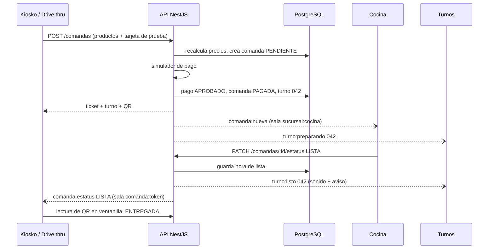

# Arquitectura de El Zarape

Decisiones técnicas del proyecto. Para el *qué* (requerimientos), ver `requirements/` y `CLAUDE.md`. Para la marca, `branding/`.

## Decisiones

| Tema | Decisión | Por qué |
|---|---|---|
| Repositorio | **Monorepo** con pnpm workspaces | Un solo lugar para las tres apps, la API, la marca y la lógica compartida. Cada app se construye y despliega aparte. |
| Apps de front end | **Tres apps** React + Vite + vite-plugin-pwa | Gestión (intranet), En sitio (restaurante) y Drive thru (pública) tienen usuarios, dispositivos y despliegues distintos. |
| Componentes de UI | **shadcn/ui** + **Tailwind CSS v4**, con el tema de la marca | Componentes accesibles (Radix) que se copian al repo y se pueden editar; estándar actual en React. |
| Animación | **Motion** (`motion/react`) | Transiciones de pantalla, ticket con animación de layout, totales que cuentan, aviso de "pedido listo". Look fresco y elegante. |
| Íconos | **Phosphor** (`@phosphor-icons/react`) como `iconLibrary` de shadcn | Seis pesos (regular, fill, duotone…) para marcar estados activos con elegancia; buen set de comida. |
| Extras de UI | Sonner (avisos), Drawer de shadcn/Vaul (ticket en móvil), shadcn Charts (dashboard), Magic UI selectivo vía registro de shadcn (p. ej. `NumberTicker`). **Sin GSAP**: Motion cubre todo y evita peso extra. | Todo compatible con shadcn; se agrega solo lo que se use. |
| Back end | **NestJS** (TypeScript) | Elegido por el equipo. Módulos claros por catálogo, guards de roles, WebSockets y Swagger integrados, y TypeScript igual que el front. |
| Base de datos | **PostgreSQL** | Relacional: catálogos con relaciones, consultas con `SUM`/`GROUP BY` para el dashboard y un modelo fácil de diagramar (entrega 14). |
| ORM | **Prisma** | El `schema.prisma` es el modelo de datos documentado; migraciones simples; se puede generar el diagrama ER desde el esquema. |
| Tiempo real | **Socket.IO** con el gateway de NestJS | Kiosko → cocina → turnos sin recargar. Reconexión automática y salas por sucursal. |
| Autenticación | **JWT** con roles, contraseñas con **bcrypt** | Dos tipos de usuario (empleado y cliente) con login separado; guards de NestJS por rol. |
| Documentación de la API | **Swagger** (`@nestjs/swagger`) | El front consulta los contratos sin preguntar al back. |
| Fotos | Disco local en desarrollo; almacenamiento de objetos en producción (p. ej. Cloudinary) | Las imágenes no viven en la BD; la BD guarda la URL. |

## Estructura del repositorio

```
zarape/
├─ apps/
│  ├─ api/          NestJS + Prisma + Socket.IO
│  ├─ admin/        Módulo I, Gestión: catálogos, búsquedas con impresión, dashboard
│  ├─ pos/          Módulo II, punto de venta en sitio: kiosko, cocina, turnos, ventanilla (lectura de QR del drive thru)
│  └─ drive-thru/   Módulo III: PWA móvil del cliente
├─ packages/
│  ├─ ui/           shadcn/ui con el tema de la marca, tokens, componentes propios (Ticket, TarjetaProducto, Turnos…) y presets de Motion
│  └─ shared/       tipos, enums de estatus, cálculo de la comanda (IVA), reglas de contraseña
├─ branding/  changelog/  docs/  requirements/
└─ pnpm-workspace.yaml
```

`packages/shared` es la única fuente del cálculo del ticket: el front lo usa para mostrar totales al instante y la API lo usa para **recalcular** con los precios de la BD (nunca se confía en los totales que manda el cliente).

## Módulos de la API (NestJS)

| Módulo | Qué hace | RF |
|---|---|---|
| `auth` | Login de empleado y de cliente, JWT, guards de rol | RF01, RF16 |
| `sucursales` | CRUD, búsqueda, cercanía por GPS | RF02, RF19 |
| `usuarios` | Empleados; genera contraseña aleatoria de 12 caracteres | RF03 |
| `categorias` | Categorías de alimentos y bebidas | RF04, RF05 |
| `alimentos`, `bebidas` | CRUD y búsqueda | RF04, RF05 |
| `combos` | CRUD con componentes de alimentos y bebidas | RF06 |
| `clientes` | Registro y perfil del drive thru, baja por estatus | RF17 |
| `comandas` | Crear al pagar, cambio de estatus, búsqueda, detalle, QR | RF09–RF11, RF15, RF19, RF20 |
| `pagos` | Simulador de pago en línea y búsqueda de pagos | RF12, RF13 |
| `tiempo-real` | Gateway Socket.IO | RF14, RF15 |
| `dashboard` | Indicadores de ventas, canales, productos, operación y mercadeo | Lineamientos del profesor |
| `archivos` | Subida de fotos | RF02, RF04, RF05 |

### Regla de eliminar (todos los catálogos)

El servicio cuenta los registros relacionados. Si hay **cero**, borra el registro. Si hay **alguno**, cambia `estatus` a `BAJA`. La respuesta le dice al front cuál de las dos pasó, para mostrar el mensaje correcto. El perfil del cliente es la excepción: **siempre** pasa a `BAJA` (RDF1702).

## Roles

| Rol | Tipo | Puede |
|---|---|---|
| `ADMIN` | Empleado | Todo el Módulo I y el dashboard. |
| `COCINA` | Empleado | Ver comandas y su detalle, cambiar estatus, leer QR en ventanilla. |
| Comensal | Sin cuenta | Kiosko: menú, comanda y pago. |
| `CLIENTE` | Cliente | Drive thru: perfil, ordenar, revisar pedido. |

## Flujo de una comanda

Estados: `PENDIENTE` → `PAGADA` → `EN_COCINA` → `LISTA` → `ENTREGADA`. Puede pasar a `CANCELADA` desde `PENDIENTE` o `PAGADA`.

1. El comensal arma el pedido; el ticket se calcula en el navegador con `packages/shared`.
2. Al pagar, la API recalcula con precios de la BD, crea la comanda `PENDIENTE` y corre el simulador.
3. Pago aprobado: la comanda pasa a `PAGADA` y recibe su número de turno (consecutivo diario por sucursal) y su token de QR. Se avisa a cocina por Socket.IO. Pago rechazado: queda `PENDIENTE` y se puede reintentar.
4. Cocina la toma (`EN_COCINA`) y al terminar la marca `LISTA`. Se avisa a la pantalla de turnos y a quien siga ese QR.
5. Kiosko: el comensal recoge con su turno. Drive thru: el personal lee el QR en ventanilla. En ambos casos queda `ENTREGADA`.



### Tiempo real

- Salas: `sucursal:{id}:cocina`, `sucursal:{id}:turnos`, `comanda:{token}`.
- La sala de cocina exige el JWT de un empleado en el handshake. Turnos y `comanda:{token}` son solo de lectura.
- El socket solo **avisa**: la fuente de verdad es REST. Al reconectar, cada pantalla vuelve a pedir su lista por REST.

## Pagos y datos de tarjeta

El pago es un **simulador**. RF13 y RF17 piden registrar número de tarjeta, vencimiento y CVV. Decisión confirmada del equipo: máxima seguridad (buenas prácticas PCI):

- El número completo y el CVV se **validan** al capturarlos (formato, Luhn, vencimiento) pero **no se guardan**.
- Se guardan: titular, marca, **últimos 4 dígitos**, mes y año de vencimiento, monto, fecha, estatus y una referencia simulada.
- Tarjetas de prueba: los números públicos de prueba de las pasarelas (p. ej. `4242 4242 4242 4242` aprueba; una lista fija de números rechaza).

## Despliegue (propuesta)

| Pieza | Dónde | Nota |
|---|---|---|
| PostgreSQL | Servicio gestionado (p. ej. Neon) | Una BD para todo. |
| API | Servicio de contenedores o Node (p. ej. Render, Railway) | HTTPS incluido. |
| `drive-thru` | Hosting estático (p. ej. Vercel, Netlify) | Dominio público con HTTPS. |
| `admin`, `pos` | Demo: hosting estático con HTTPS y login por rol. Restaurante real: servidor en la red local con HTTPS (p. ej. Caddy) | Cumple NF01/NF02 en producción; los service workers exigen HTTPS. |

## Pruebas (entrega 15)

- **Unitarias** con **Vitest** en todo el repo (NestJS 12 ya trae Vitest en lugar de Jest): cálculo de comanda e IVA, regla de eliminar, contraseña aleatoria, reglas de contraseña del cliente.
- **Integración / e2e** (Vitest + Supertest): flujo de pago → comanda → cambio de estatus.
- **Auditoría Lighthouse** de las tres apps (meta ≥ 90 en rendimiento y accesibilidad).

## Versiones y herramientas

Base del esqueleto (noviembre 2026). Los comandos están en `CLAUDE.md`, sección Comandos.

| Pieza | Versión | Nota |
|---|---|---|
| Node.js | 24 LTS (mínimo 22.12) | `.nvmrc` |
| pnpm | 12 | Fijado en `packageManager`. Rechaza versiones publicadas hace menos de un día (`minimumReleaseAge`). Solo Prisma puede correr scripts de instalación (`allowBuilds`). |
| TypeScript | 6.0 | TypeScript 7 todavía no lo soportan NestJS ni Swagger. |
| NestJS | 12 (ESM) | Imports relativos con extensión `.js`. |
| Prisma | 7 | Generador `prisma-client` (cliente en `apps/api/src/generated`), adaptador `@prisma/adapter-pg`, URL en `prisma.config.ts`. |
| React / Vite / Tailwind | 19 / 8 / 4 | |
| shadcn/ui | 4, estilo `radix-nova` | Componentes en `packages/ui/src/components`, íconos Phosphor. |
| Motion / vite-plugin-pwa | 14 / 2 | |
| Pruebas / lint | Vitest 5 / oxlint | oxlint es el linter de las plantillas actuales de Vite y NestJS; una sola configuración en la raíz. |

`packages/shared` se compila a `dist/` para la API. Las apps de Vite leen su código fuente directo con la condición de exports `@zarape/source`, sin compilar antes.

## Pendiente de confirmar

- Proveedores de despliegue y de fotos.
- Herramienta de tareas del monorepo (pnpm solo o pnpm + Turborepo).
