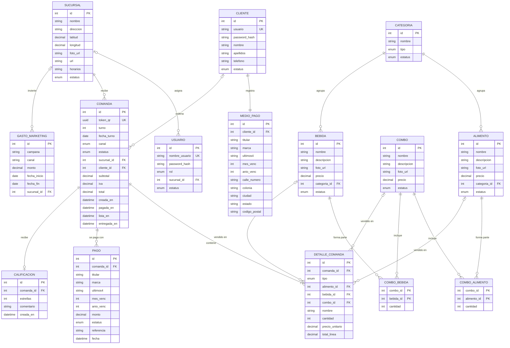

# Modelo de datos de El Zarape

Modelo relacional en PostgreSQL. La fuente de verdad será `apps/api/prisma/schema.prisma`: si algo cambia ahí, se actualiza este documento. Base para la entrega 14 (diagramación de la base de datos).

## Diagrama entidad-relación

## Enums

| Enum | Valores |
|---|---|
| `estatus` (catálogos incluidas las categorías, usuario, cliente) | `ACTIVO`, `BAJA` |
| `rol` | `ADMIN`, `COCINA` |
| `CATEGORIA.tipo` | `ALIMENTO`, `BEBIDA` |
| `COMANDA.canal` | `KIOSKO`, `DRIVE_THRU` |
| `COMANDA.estatus` | `PENDIENTE`, `PAGADA`, `EN_COCINA`, `LISTA`, `ENTREGADA`, `CANCELADA` |
| `DETALLE_COMANDA.tipo` | `ALIMENTO`, `BEBIDA`, `COMBO` |
| `PAGO.estatus` | `APROBADO`, `RECHAZADO` |

## Reglas del modelo

- **Dinero** en `decimal(10,2)`, nunca `float`. Los precios del catálogo incluyen IVA; la comanda guarda `subtotal`, `iva` y `total` calculados por la API.
- **Detalle con foto fija del momento:** `DETALLE_COMANDA` copia `nombre` y `precio_unitario`. Si el precio cambia después, los tickets viejos no cambian.
- **Un solo producto por línea:** en `DETALLE_COMANDA` solo uno de `alimento_id`, `bebida_id` o `combo_id` tiene valor, según `tipo` (restricción `CHECK`).
- **Comanda del kiosko sin cliente:** `cliente_id` es nulo en el canal `KIOSKO` y obligatorio en `DRIVE_THRU` (restricción `CHECK`).
- **Turno:** consecutivo diario por sucursal (índice único en `sucursal_id` + `fecha_turno` + `turno`). `turno` y `fecha_turno` (día local en que se pagó) se asignan juntos al pagar (restricción `CHECK`); antes los dos son nulos.
- **Fechas y horas** en `timestamptz`, para que las horas del dashboard no dependan de la zona del servidor.
- Las restricciones `CHECK` no caben en `schema.prisma`: viven en la migración inicial (`apps/api/prisma/migrations/20261108000000_inicial/migration.sql`). Prisma no las borra en migraciones nuevas.
- **QR:** guarda `token_qr` (UUID), nunca el `id` consecutivo, para que nadie adivine pedidos ajenos.
- **Tarjetas:** solo últimos 4 dígitos, marca y vencimiento. Nunca número completo ni CVV (ver `docs/arquitectura.md`).
- **Eliminar:** borrado físico solo si no hay registros relacionados; si los hay, `estatus = BAJA`. `CLIENTE` siempre pasa a `BAJA`.
- **Horas de la comanda** (`pagada_en`, `lista_en`, `entregada_en`): dan el tiempo de preparación del dashboard.

## De dónde sale cada indicador del dashboard

| Indicador | Cálculo |
|---|---|
| Ventas totales, por sucursal, por canal | `SUM(total)` de comandas pagadas, agrupado por `sucursal_id` o `canal` |
| Ticket promedio | `AVG(total)` de comandas pagadas |
| Productos y combos más vendidos | `SUM(cantidad)` en `DETALLE_COMANDA` por producto |
| Horarios de mayor demanda | Comandas por hora de `pagada_en` |
| Comandas por estatus | `COUNT` por `estatus` |
| Tiempo promedio de preparación | `AVG(lista_en - pagada_en)` |
| Clientes registrados y recompra | `CLIENTE` activos; clientes con 2 o más comandas en 30 días |
| Costo de adquisición y ROI | `GASTO_MARKETING` contra clientes nuevos e ingresos del periodo |
| Satisfacción | `AVG(estrellas)` de `CALIFICACION` |
