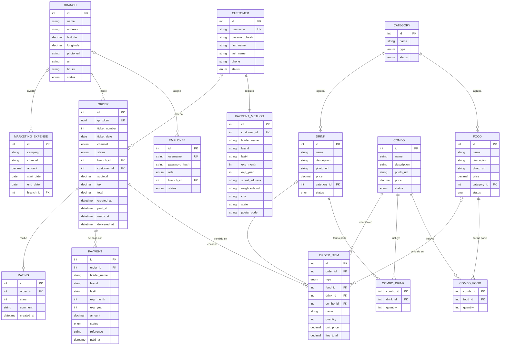

# Modelo de datos de El Zarape

Modelo relacional en PostgreSQL. La fuente de verdad será `apps/api/prisma/schema.prisma`: si algo cambia ahí, se actualiza este documento. Base para la entrega 14 (diagramación de la base de datos).

Tablas, columnas y enums van en inglés (convención del código). Equivalencias con el documento de requerimientos:

| Inglés | Español |
|---|---|
| `branch` | Sucursal |
| `employee` | Usuario (empleado) |
| `category` | Categoría |
| `food` | Alimento |
| `drink` | Bebida |
| `combo` | Combo |
| `customer` | Cliente |
| `payment_method` | Medio de pago |
| `order` | Comanda |
| `order_item` | Detalle de comanda |
| `payment` | Pago |
| `marketing_expense` | Gasto de mercadeo |
| `rating` | Calificación |
| `ticket_number` | Turno |
| `qr_token` | Token del QR |
| `tax` | IVA |

## Diagrama entidad-relación

## Enums

| Enum | Valores |
|---|---|
| `status` (catálogos incluidas las categorías, empleado, cliente) | `ACTIVE`, `INACTIVE` (baja) |
| `role` | `ADMIN`, `KITCHEN` |
| `category.type` | `FOOD`, `DRINK` |
| `order.channel` | `KIOSK`, `DRIVE_THRU` |
| `order.status` | `PENDING`, `PAID`, `IN_KITCHEN`, `READY`, `DELIVERED`, `CANCELLED` |
| `order_item.type` | `FOOD`, `DRINK`, `COMBO` |
| `payment.status` | `APPROVED`, `DECLINED` |

## Reglas del modelo

- **Dinero** en `decimal(10,2)`, nunca `float`. Los precios del catálogo incluyen IVA; la comanda guarda `subtotal`, `tax` y `total` calculados por la API.
- **Detalle con foto fija del momento:** `order_item` copia `name` y `unit_price`. Si el precio cambia después, los tickets viejos no cambian.
- **Un solo producto por línea:** en `order_item` solo uno de `food_id`, `drink_id` o `combo_id` tiene valor, según `type` (restricción `CHECK`).
- **Comanda del kiosko sin cliente:** `customer_id` es nulo en el canal `KIOSK` y obligatorio en `DRIVE_THRU` (restricción `CHECK`).
- **Turno:** `ticket_number`, consecutivo diario por sucursal (índice único en `branch_id` + `ticket_date` + `ticket_number`). Los dos se asignan juntos al pagar (restricción `CHECK`); antes son nulos.
- **Fechas y horas** en `timestamptz`, para que las horas del dashboard no dependan de la zona del servidor.
- Las restricciones `CHECK` no caben en `schema.prisma`: viven en la migración inicial (`apps/api/prisma/migrations/20261110000000_init/migration.sql`). Prisma no las borra en migraciones nuevas.
- **QR:** guarda `qr_token` (UUID), nunca el `id` consecutivo, para que nadie adivine pedidos ajenos.
- **Tarjetas:** solo últimos 4 dígitos, marca y vencimiento. Nunca número completo ni CVV (ver `docs/arquitectura.md`).
- **Eliminar:** borrado físico solo si no hay registros relacionados; si los hay, `status = INACTIVE`. `customer` siempre pasa a `INACTIVE`.
- **Horas de la comanda** (`paid_at`, `ready_at`, `delivered_at`): dan el tiempo de preparación del dashboard.

## De dónde sale cada indicador del dashboard

| Indicador | Cálculo |
|---|---|
| Ventas totales, por sucursal, por canal | `SUM(total)` de comandas pagadas, agrupado por `branch_id` o `channel` |
| Ticket promedio | `AVG(total)` de comandas pagadas |
| Productos y combos más vendidos | `SUM(quantity)` en `order_item` por producto |
| Horarios de mayor demanda | Comandas por hora de `paid_at` |
| Comandas por estatus | `COUNT` por `status` |
| Tiempo promedio de preparación | `AVG(ready_at - paid_at)` |
| Clientes registrados y recompra | `customer` activos; clientes con 2 o más comandas en 30 días |
| Costo de adquisición y ROI | `marketing_expense` contra clientes nuevos e ingresos del periodo |
| Satisfacción | `AVG(stars)` de `rating` |
